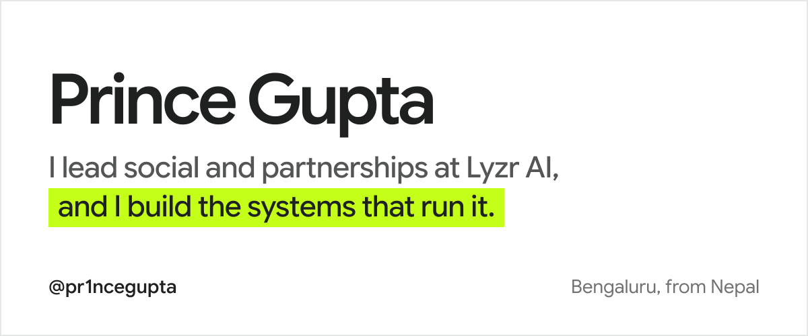
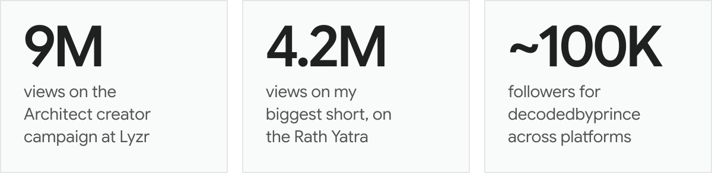
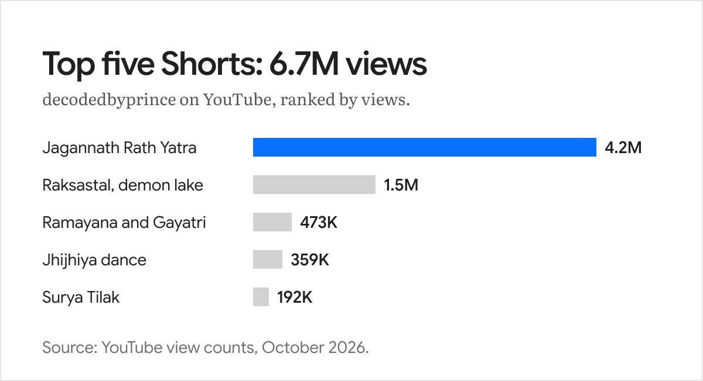
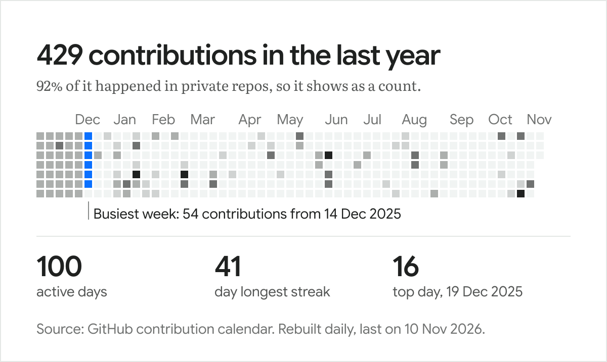

<!-- Every image here is an outlined SVG built by build_assets.py. Edit the copy there, not in the SVGs. -->

<picture>
  <source media="(prefers-color-scheme: dark)" srcset="assets/header-dark.svg">
  
</picture>

  <a href="https://linkedin.com/in/pr1ncegupta">LinkedIn</a> &nbsp;·&nbsp;
  <a href="https://x.com/pr1ncegupta">X</a> &nbsp;·&nbsp;
  <a href="https://instagram.com/decodedbyprince">Instagram</a> &nbsp;·&nbsp;
  <a href="https://youtube.com/@decodedbyprince">YouTube</a> &nbsp;·&nbsp;
  <a href="https://hiiprince.com">hiiprince.com</a>

Creative strategist at [Lyzr AI](https://www.lyzr.ai). By day I run social and creator partnerships for a company that builds agentic systems for enterprises. By night I make short documentaries about temples, lakes and myths as [decodedbyprince](https://youtube.com/@decodedbyprince), for close to 100K people.

Computer science engineer by degree, marketer by trade. So when the work starts repeating itself, I build the tool that takes the repetition away.

<picture>
  <source media="(prefers-color-scheme: dark)" srcset="assets/numbers-dark.svg">
  
</picture>

- **9M views from 1,000 creator videos** on Lyzr's Architect campaign, across LinkedIn, X, Instagram and TikTok in 3 months. I ran it end to end, with creators directly and through agencies.
- **300K+ impressions** on LinkedIn posts I wrote
- **Former GDSC Lead** at Jain University, featured by Google for Developers

## decodedbyprince

It took a few channels that did not work, and a year and a half, to find this one. These five Shorts did the most.

<picture>
  <source media="(prefers-color-scheme: dark)" srcset="assets/hits-dark.svg">
  
</picture>

Watch them: [Jagannath Rath Yatra](https://youtube.com/shorts/amIcr0F6trA) &nbsp;·&nbsp; [The Demonic Lake Raksastal](https://youtube.com/shorts/CGcfzZsxB-4) &nbsp;·&nbsp; [Ramayana and the Gayatri Mantra](https://youtube.com/shorts/472aZWHc_Yk) &nbsp;·&nbsp; [The Jhijhiya Dance of Mithila](https://youtube.com/shorts/-SRdDCJpRhw) &nbsp;·&nbsp; [Surya Tilak of Ram Lalla](https://youtube.com/shorts/15Hqeejqly0)

## At Lyzr

Joined as an intern in April 2025, and went full time in January 2026. These days I look after organic social across LinkedIn, X, Instagram and Reddit, our creator and influencer partnerships, and how AI assistants like ChatGPT talk about Lyzr when someone asks. I also hire and run our intern team.

## Things I have built

| | |
| :-- | :-- |
| [**TL;DR**](https://tldr-p.vercel.app) | Paste any text, get the summary and the action points. Four AI agents on Lyzr do the work. |
| **My content engine** | A set of Claude skills that takes a decodedbyprince episode from first hook to upload. |
| [**hiiprince.com**](https://hiiprince.com) | My corner of the internet, built in Next.js. |
| [**VoiceMind**](https://github.com/pr1ncegupta/voicemind-public) | A voice-first mental health companion, in Flutter and FastAPI. |
| [**deforestation-ml**](https://github.com/pr1ncegupta/deforestation-ml) | Spots deforestation in satellite images. |

## On GitHub

<picture>
  <source media="(prefers-color-scheme: dark)" srcset="assets/contributions-dark.svg">
  
</picture>

## Say hii

Partnerships, podcasts and creator collabs: [LinkedIn](https://linkedin.com/in/pr1ncegupta) is the fastest way to reach me.

And if we ever meet, ask me about [Kukur Tihar](https://youtube.com/shorts/Euwf8CR7tlg), the day Nepal worships dogs. I will not stop talking.
