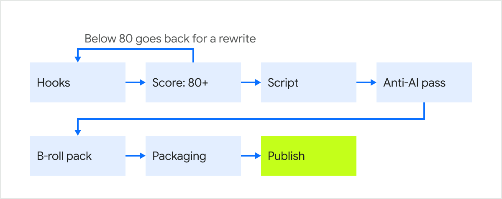

<!-- Every image here is an outlined SVG built by build_assets.py. Edit the copy there, not in the SVGs. -->

<picture>
  <source media="(prefers-color-scheme: dark)" srcset="assets/header-dark.svg">
  
</picture>

Most hooks get picked on gut feeling. Mine get a score out of 100 first, and anything under 80 goes back for a rewrite.

That is the whole idea of this page. My day job is social and partnerships at [Lyzr AI](https://www.lyzr.ai), where we build agentic systems for enterprises. My night job is [decodedbyprince](https://instagram.com/decodedbyprince), a documentary channel on archaeology and myth. I studied computer science engineering, so when a task repeats, I write the tool. Below is what those tools taught me, free to steal.

<picture>
  <source media="(prefers-color-scheme: dark)" srcset="assets/numbers-dark.svg">
  
</picture>

## Quick game: which hook ships?

Same video. Two openers. One of them goes out.

> **A.** America almost put a turkey on its Great Seal.
>
> **B.** Ben Franklin called the bald eagle a thief and a coward. In writing.

<b>Pick one, then click</b>

 

**B ships, with 86 out of 100.** Nobody expects a Founding Father to trash the national bird, it reads fine on mute, and "in writing" tells you there are receipts.

**A never gets scored.** It states a myth as a fact, and the video spends a minute proving it wrong. A hook that lies fails the honesty gate, and no score saves it.

Want A to work? Frame the myth as a belief: *"Everyone thinks Franklin wanted a turkey on the seal. He actually called the eagle a coward."* That clears 80.

## Steal my hook rubric

I call it the Thumb-Stop Score. A hook has two jobs: stop the scroll, then make them stay.

| Job | What I check | Points |
| :-- | :-- | --: |
| **Stop** | Pattern break: does it say something they did not see coming? | 25 |
| | Clarity on mute: one read, sound off, about 12 words | 15 |
| | Sharpness: one real number, name or image | 10 |
| **Stay** | Curiosity gap: a question the brain needs closed | 30 |
| | Stakes: surprise, tension, or "this is about me" | 20 |
| **Gate** | Honesty: can the video actually pay this off? | pass or fail |

The part most people miss: a hook that is good at everything lands around 80, right on the cutoff. Good is not enough. At least one part has to be great.

## Words that never make it out

Every script, caption and post goes through an anti-AI pass before it ships. These words do not survive it:

~~delve~~ &nbsp; ~~tapestry~~ &nbsp; ~~testament~~ &nbsp; ~~leverage~~ &nbsp; ~~robust~~ &nbsp; ~~seamless~~ &nbsp; ~~pivotal~~ &nbsp; ~~vibrant~~ &nbsp; ~~game-changer~~ &nbsp; ~~deep dive~~

Neither does "it's not X, it's Y", the loudest tell of all. The 2026 tells are sneakier, because they sound plain: *quietly*, *steady*, *practical*, and "this matters". If your copy reads like a press release with good posture, start there.

## How a video gets made

One episode, seven steps, and most of them run on Claude skills I wrote. Each step's output is the next step's input.

<picture>
  <source media="(prefers-color-scheme: dark)" srcset="assets/engine-dark.svg">
  
</picture>

<b>What each step does</b>

 

| Step | What happens |
| :-- | :-- |
| Hooks | A pool of 6 to 10 openers, each from a different angle |
| Score | The rubric above. Under 80 or dishonest, it goes back |
| Script | A one-minute, talking-to-camera script built on the winning hook |
| Anti-AI pass | The word list above, plus rhythm: no page of clipped, same-length sentences |
| B-roll pack | A shot list for the editor, with a source for every line |
| Packaging | Thumbnail text, title, tags and description in one go |

## At Lyzr

Joined as an intern in April 2025, full time since January 2026. Three things I would show anyone:

- **The Architect campaign.** A creator campaign that reached 9M views.
- **Getting AI to talk about us.** People ask ChatGPT before they search now. I track how LLMs cite Lyzr in their answers and feed what I find into what we publish. The name for it is generative engine optimisation.
- **[TL;DR](https://github.com/pr1ncegupta/TLDR-P).** Paste any text, get a summary and action points from four agents running on Lyzr. A demo that doubles as working software. [Try it](https://tldr-p.vercel.app).

## Side quests

Code I wrote for fun, or for a deadline.

| Repo | What it does |
| :-- | :-- |
| [hiiprince.com](https://hiiprince.com) | My portfolio, in Next.js |
| [voicemind-public](https://github.com/pr1ncegupta/voicemind-public) | A voice-first mental health companion, in Flutter and FastAPI |
| [deforestation-ml](https://github.com/pr1ncegupta/deforestation-ml) | Spots deforestation in satellite images, with a Streamlit front end |

## Receipts

The commit chart below redraws itself every night, using the same script that draws every image on this page.

<picture>
  <source media="(prefers-color-scheme: dark)" srcset="assets/contributions-dark.svg">
  
</picture>

## Send me a hook

Got an opener you are unsure about? Send it on [LinkedIn](https://linkedin.com/in/pr1ncegupta) or [X](https://x.com/pr1ncegupta) and I will run it through the rubric. Or ask me about Göbekli Tepe. Either works.

[LinkedIn](https://linkedin.com/in/pr1ncegupta) &nbsp;·&nbsp; [X](https://x.com/pr1ncegupta) &nbsp;·&nbsp; [Instagram](https://instagram.com/decodedbyprince) &nbsp;·&nbsp; [hiiprince.com](https://hiiprince.com)
