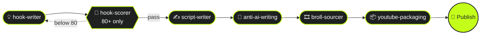
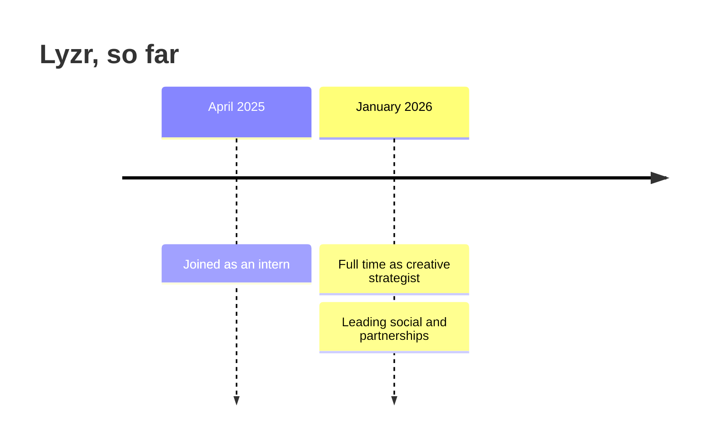

<!-- Header and stats images are built by build_assets.py. Edit the copy there, not in the SVGs. -->

<picture>
  <source media="(prefers-color-scheme: dark)" srcset="assets/header-dark.svg">
  
</picture>

<picture>
  <source media="(prefers-color-scheme: dark)" srcset="https://readme-typing-svg.demolab.com?font=Fira+Code&weight=500&size=20&duration=2800&pause=900&color=C4FF1A&center=true&vCenter=true&width=640&lines=Creative+strategist+at+Lyzr+AI;Documentary+storyteller+at+decodedbyprince;When+the+work+repeats%2C+I+write+the+tool;Bengaluru%2C+from+Nepal">
  
</picture>

 

I am a creative strategist at [Lyzr AI](https://www.lyzr.ai), an enterprise agentic AI platform. I studied computer science engineering at Jain University, so when the content work starts repeating itself, I write the tool that takes the repetition away.

<picture>
  <source media="(prefers-color-scheme: dark)" srcset="assets/numbers-dark.svg">
  
</picture>

> [!TIP]
> **The short version:** I am a marketer who writes code. The numbers above come from systems I built, not from posting harder. Below is how each one works.

---

## 🚀 Featured work

### 1. The content engine &nbsp; 

**Problem.** A documentary channel needs a hook, a script, an edit plan and an upload pack for every episode, and doing it by hand capped how often I could ship.
**What I built.** A chain of Claude skills, one per stage, where each skill's output is the next one's input. Hooks get scored on a fixed rubric and only the ones above 80 move on.
**Result.** [decodedbyprince](https://instagram.com/decodedbyprince) at close to 100K followers across platforms in 1.5 years.

<b>🤖 Every skill in the engine</b>

 

| Stage | Skill | Job |
| :-- | :-- | :-- |
| Hooks | `hook-writer` | Writes a pool of 6 to 10 openers from a topic or rough notes |
| Hooks | `hook-scorer` | Scores each hook on a rubric and only passes the ones above 80 |
| Script | `nas-daily-script-writer` | Turns a picked hook into a one-minute talking-to-camera script |
| Script | `final-script-polish` | Rewrites a single line or beat without regenerating the whole thing |
| Edit | `anti-ai-writing` | Strips the tells that make copy read machine-written |
| Edit | `patchnote-broll-sourcer` | Gives the editor a shot list with a source for every line |
| Social | `carousel-architect` | Picks three carousel formats for a source and writes every slide |
| Ship | `decodedbyprince-youtube-packaging` | Thumbnail text, title, tags and description in one pass |

### 2. Generative engine optimisation at Lyzr &nbsp; 

Search is moving into chat answers, so I track how LLMs cite Lyzr in their answers and feed what I find back into the content plan.[^geo]

### 3. The Architect creator campaign &nbsp; 

A creator and influencer campaign I ran for Lyzr that reached **9M views**.

### 4. TL;DR, a product demo on Lyzr agents &nbsp; 

[TL;DR](https://github.com/pr1ncegupta/TLDR-P) turns any text into a summary and action points using four AI agents running on Lyzr. It is a marketing asset that is also working software: [try it live](https://tldr-p.vercel.app).

### 5. Second brain &nbsp; 

One Notion task table across work and life, with Slack digests twice a day, so nothing from a campaign falls through between meetings.

---

## 🧭 At Lyzr

- [x] Organic social across **LinkedIn, X, Instagram and Reddit**
- [x] Personal branding and podcast outreach for Lyzr's leadership
- [x] Creator and influencer partnerships, including the **Architect** campaign
- [x] Generative engine optimisation
- [x] Hiring and running a team of interns

---

## 🏛️ decodedbyprince

A documentary channel on archaeology, mythology and sacred places, made with the content engine above.

<b>📍 Recent stories</b> (click to open)

 

| | Story | Where |
| :-: | :-- | :-- |
| 🗿 | **Göbekli Tepe** | Şanlıurfa, Türkiye |
| 💀 | **Roopkund**, the skeleton lake | Uttarakhand, India |
| 🛕 | **Kailasa Temple**, cut from one rock | Ellora, India |
| 🕳️ | **Derinkuyu**, the underground city | Cappadocia, Türkiye |
| 🦁 | **Sigiriya**, the lion rock | Central Province, Sri Lanka |

---

## 💻 Code I ship

| Build | What it is | Stack |
| :-- | :-- | :-- |
| [**hiiprince.com**](https://hiiprince.com) | My portfolio site |  |
| [**voicemind-public**](https://github.com/pr1ncegupta/voicemind-public) | A voice-first AI mental health companion with emotion fusion, crisis detection and an offline coping engine |   |
| [**deforestation-ml**](https://github.com/pr1ncegupta/deforestation-ml) | Deforestation monitoring from satellite imagery, with a Streamlit front end |  |
| [**ai-bharat-teacherOS**](https://github.com/pr1ncegupta/ai-bharat-teacherOS) | Classroom management tools for rural teachers |  |
| **Cobra** | A scorekeeper for the Cobra card game |  |

---

## 🧰 Tools

<table>
  <tr>
    <td><b>Code</b></td>
    <td></td>
  </tr>
  <tr>
    <td><b>AI and ops</b></td>
    <td>
      
      
      
    </td>
  </tr>
  <tr>
    <td><b>Design and video</b></td>
    <td>
      
      
    </td>
  </tr>
</table>

---

## 📈 On GitHub

<picture>
  <source media="(prefers-color-scheme: dark)" srcset="https://streak-stats.demolab.com?user=pr1ncegupta&hide_border=true&background=1f2120&ring=c4ff1a&fire=c4ff1a&currStreakNum=ffffff&sideNums=ffffff&currStreakLabel=c4ff1a&sideLabels=e4e7e5&dates=acafad&stroke=414342">
  
</picture>

  

<picture>
  <source media="(prefers-color-scheme: dark)" srcset="https://raw.githubusercontent.com/pr1ncegupta/pr1ncegupta/output/snake-dark.svg">
  
</picture>

---

## 📬 Find me

**Partnerships, podcasts, or a creator collab with Lyzr?** <kbd>LinkedIn</kbd> is fastest.

[LinkedIn](https://linkedin.com/in/pr1ncegupta) &nbsp;·&nbsp; [X](https://x.com/pr1ncegupta) &nbsp;·&nbsp; [Instagram](https://instagram.com/decodedbyprince) &nbsp;·&nbsp; [hiiprince.com](https://hiiprince.com)

 

[^geo]: Generative engine optimisation is the search-engine-optimisation idea applied to LLM answers instead of search results.
