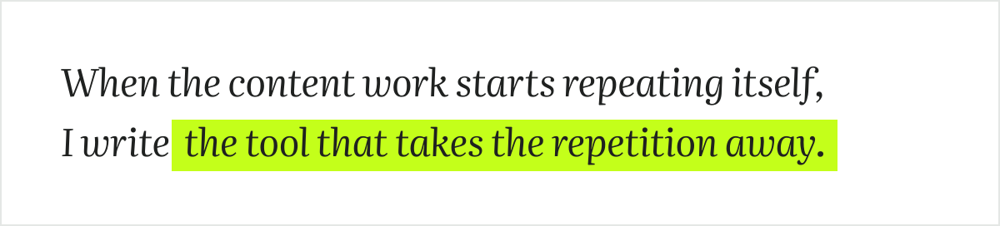

<!-- Every image here is an outlined SVG built by build_assets.py. Edit the copy there, not in the SVGs. -->

<picture>
  <source media="(prefers-color-scheme: dark)" srcset="assets/header-dark.svg">
  
</picture>

<p align="center">
  <a href="#work">Work</a> &nbsp;·&nbsp;
  <a href="#lyzr">Lyzr</a> &nbsp;·&nbsp;
  <a href="#decodedbyprince">decodedbyprince</a> &nbsp;·&nbsp;
  <a href="#code">Code</a> &nbsp;·&nbsp;
  <a href="#commits">Commits</a> &nbsp;·&nbsp;
  <a href="#colophon">Colophon</a>
</p>

I am a creative strategist at [Lyzr AI](https://www.lyzr.ai), an enterprise agentic AI platform. I also studied computer science engineering at Jain University, and that shows up in how I do the marketing job:

<picture>
  <source media="(prefers-color-scheme: dark)" srcset="assets/quote-dark.svg">
  
</picture>

<picture>
  <source media="(prefers-color-scheme: dark)" srcset="assets/numbers-dark.svg">
  
</picture>

```yaml
# about.yaml
name: Prince Gupta
role: Creative strategist, Lyzr AI
based_in: Bengaluru
from: Nepal
day_job: [organic social, creator partnerships, GEO, leadership branding]
side_project: decodedbyprince   # archaeology, mythology, sacred places
rule: if a task repeats, it becomes a tool
```

<br>

<a id="work"></a>

## 01 &nbsp; Featured work

Five things I built. Each one is written up the same way: the brief, what I built, and what came of it.

### The content engine

<sub>Claude skills &nbsp;·&nbsp; 8 stages &nbsp;·&nbsp; runs on every episode</sub>

**Brief.** A documentary channel needs a hook, a script, an edit plan and an upload pack for every episode. Doing it all by hand capped how often I could ship.<br>
**Built.** A chain of Claude skills, one per stage, where each skill's output is the next one's input. Hooks get scored on a fixed rubric, and only the ones above 80 move on.<br>
**Result.** [decodedbyprince](https://instagram.com/decodedbyprince) at close to 100K followers across platforms in 1.5 years.

<picture>
  <source media="(prefers-color-scheme: dark)" srcset="assets/engine-dark.svg">
  
</picture>

<details>
<summary><b>Every skill in the engine</b></summary>
<br>

| Stage | Skill | Job |
| :-- | :-- | :-- |
| Hooks | `hook-writer` | Writes a pool of 6 to 10 openers from a topic or rough notes |
| Hooks | `hook-scorer` | Scores each hook on a rubric and only passes the ones above 80 |
| Script | `nas-daily-script-writer` | Turns a picked hook into a one-minute talking-to-camera script |
| Script | `final-script-polish` | Rewrites a single line or beat without regenerating the whole thing |
| Edit | `anti-ai-writing` | Strips the tells that make copy read machine-written |
| Edit | `patchnote-broll-sourcer` | Gives the editor a shot list with a source for every line |
| Social | `carousel-architect` | Picks three carousel formats for a source and writes every slide |
| Ship | `decodedbyprince-youtube-packaging` | Thumbnail text, title, tags and description in one pass |

</details>

### Generative engine optimisation at Lyzr

<sub>GEO &nbsp;·&nbsp; LLM citations &nbsp;·&nbsp; ongoing</sub>

**Brief.** People now ask a chatbot before they search, and a brand the model never cites is missing from that answer.<br>
**Built.** Tracking of how LLMs cite Lyzr in their answers, fed back into what we publish next.[^geo]

### The Architect creator campaign

<sub>Creator partnerships &nbsp;·&nbsp; Lyzr</sub>

**Built.** A creator and influencer campaign for Lyzr.<br>
**Result.** **9M views.**

### TL;DR, a product demo on Lyzr agents

<sub>TypeScript &nbsp;·&nbsp; 4 agents &nbsp;·&nbsp; <a href="https://tldr-p.vercel.app">live</a></sub>

**Built.** [TL;DR](https://github.com/pr1ncegupta/TLDR-P), which turns any text into a summary and action points using four AI agents on Lyzr. It is a marketing asset that is also working software.

### Second brain

<sub>Notion &nbsp;·&nbsp; Slack</sub>

**Built.** One Notion task table across work and life, with Slack digests twice a day, so nothing from a campaign falls through between meetings.

<br>

<a id="lyzr"></a>

## 02 &nbsp; At Lyzr

```diff
@@ lyzr/changelog.md @@
+ Jan 2026   Full time as creative strategist
+            Leading social and partnerships, hiring and running the intern team
+ Apr 2025   Joined as an intern
```

What the job covers today:

- Organic social across LinkedIn, X, Instagram and Reddit
- Personal branding and podcast outreach for Lyzr's leadership
- Creator and influencer partnerships, including the Architect campaign
- Generative engine optimisation
- Hiring and running a team of interns

<br>

<a id="decodedbyprince"></a>

## 03 &nbsp; decodedbyprince

A documentary channel on archaeology, mythology and sacred places, made with the content engine above. Find it on [Instagram](https://instagram.com/decodedbyprince).

<details>
<summary><b>Recent stories</b></summary>
<br>

| Story | Where |
| :-- | :-- |
| **Göbekli Tepe** | Şanlıurfa, Türkiye |
| **Roopkund**, the skeleton lake | Uttarakhand, India |
| **Kailasa Temple**, cut from one rock | Ellora, India |
| **Derinkuyu**, the underground city | Cappadocia, Türkiye |
| **Sigiriya**, the lion rock | Central Province, Sri Lanka |

</details>

<br>

<a id="code"></a>

## 04 &nbsp; Code I ship

| Build | What it is | Stack |
| :-- | :-- | :-- |
| [**hiiprince.com**](https://hiiprince.com) | My portfolio site | `Next.js` |
| [**voicemind-public**](https://github.com/pr1ncegupta/voicemind-public) | A voice-first AI mental health companion with emotion fusion, crisis detection and an offline coping engine | `Flutter` `FastAPI` |
| [**deforestation-ml**](https://github.com/pr1ncegupta/deforestation-ml) | Deforestation monitoring from satellite imagery, with a Streamlit front end | `Python` |
| [**ai-bharat-teacherOS**](https://github.com/pr1ncegupta/ai-bharat-teacherOS) | Classroom management tools for rural teachers | `AI` |
| **Cobra** | A scorekeeper for the Cobra card game | `React` |

**Stack by job**

| Job | Tools |
| :-- | :-- |
| Build | `TypeScript` `Next.js` `React` `Tailwind` `Python` `FastAPI` |
| Automate | `Claude` `Notion` `Slack` |
| Make | `Figma` `Final Cut Pro` |

<br>

<a id="commits"></a>

## 05 &nbsp; Commit log

<picture>
  <source media="(prefers-color-scheme: dark)" srcset="assets/contributions-dark.svg">
  
</picture>

<br>

## Find me

[LinkedIn](https://linkedin.com/in/pr1ncegupta) &nbsp;·&nbsp; [X](https://x.com/pr1ncegupta) &nbsp;·&nbsp; [Instagram](https://instagram.com/decodedbyprince) &nbsp;·&nbsp; [hiiprince.com](https://hiiprince.com)

Partnerships, podcasts or a creator collab with Lyzr: LinkedIn is fastest. Good openers are Göbekli Tepe, hook scoring, or getting an LLM to cite your brand.

<a id="colophon"></a>

<details>
<summary><b>Colophon</b></summary>
<br>

Set in Google Sans Flex for anything you glance at and Literata for anything you read. The palette is Carbon Black and White with one chartreuse signal, and Digital Blue for data.

Every image on this page is an SVG with its text outlined to paths, so it looks the same on every screen. [`build_assets.py`](build_assets.py) draws them, and a [GitHub Action](.github/workflows/assets.yml) redraws the commit chart every night from the contribution calendar.

</details>

[^geo]: Generative engine optimisation is the search-engine-optimisation idea applied to LLM answers instead of search results.
